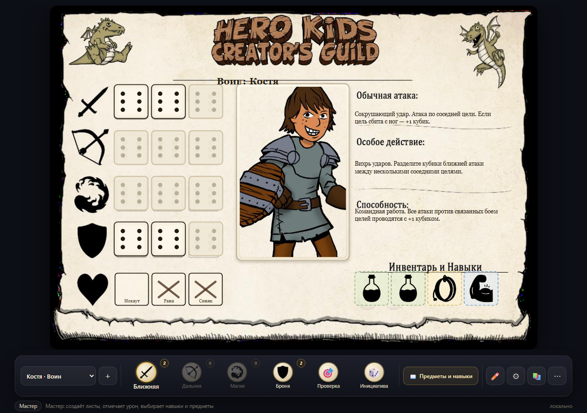
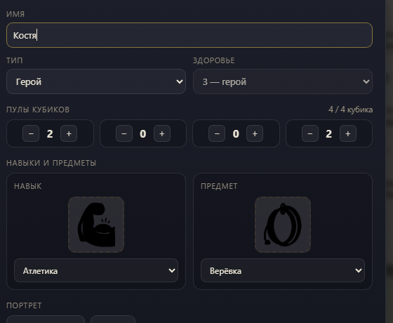
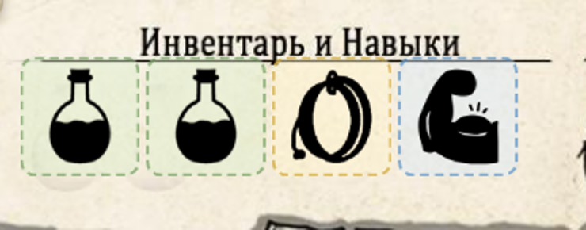
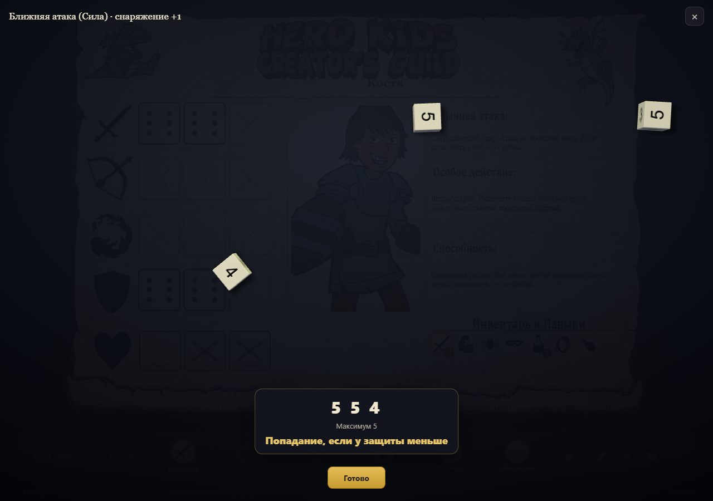
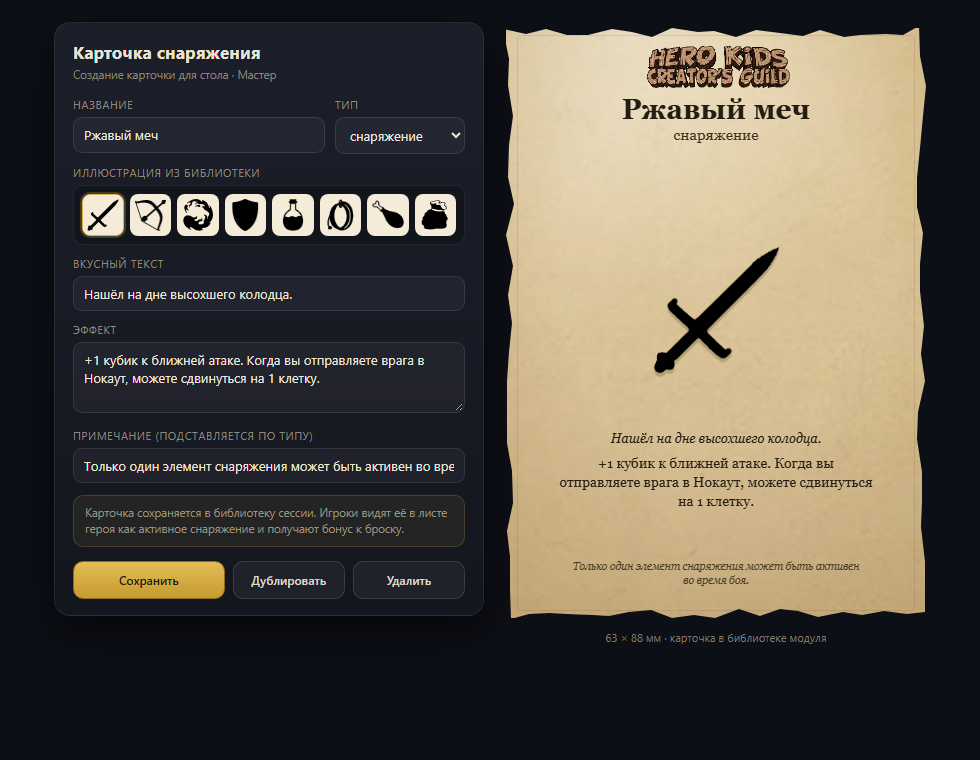

# Hero Kids в VTT 2.0 — реализация

Статус: **реализовано**.
Источник правил: `Hero_Kids_-_Kniga_TsV.pdf` (рус. пер. А. Плиско, версия 3.0,
сборка 116, 53 стр.). Ссылки на страницы книги — по нумерации в подвале.



---

## 1. Коротко

Сделан один модуль-расширение `herokids`: лист персонажа и карточки предметов
живут в одном окне и в одном состоянии сессии.

| Что                | Для кого                          | Где                                            |
| ------------------ | --------------------------------- | ---------------------------------------------- |
| Лист героя/монстра | Мастер создаёт, игроки бросают     | основное окно модуля                           |
| Карточки предметов | Мастер создаёт и выдаёт, игроки смотрят | кнопка 📖 «Библиотека»                    |
| Библиотека иконок  | Мастер выбирает                   | кнопка 📚; клик по навыку у игрока — проверка   |

Отдельного бестиария нет: монстр — такой же лист, как герой, только с другим
набором полей (меньше клеток здоровья, нет «Инвентаря и навыков»). Мастер
создаёт монстров в том же модуле и видит их в общем списке, игроки — только
своих героев.

Ключевые решения:

- **Лист — это карточка из книги.** Фон — пустая карточка героя (стр. 26),
  поверх неё интерактивные поля. Никакой «своей» вёрстки, максимум узнаваемости.
- **Один формат для героев и монстров.** Различаются только числом клеток
  здоровья и видимостью раздела «Инвентарь и навыки»; вся механика броска общая.
- **Мастер создаёт и заполняет, игрок только бросает.** Запись состояния
  разрешена только Мастеру (`playerWritable: false`), сервер это уже умеет
  проверять. Урон отмечает только Мастер. Игрок получает броски, проверки,
  предметы и 3D-кубики.
- **Кубики бросаются внутри листа.** Переиспользуем движок `dice-box-threejs`
  из модуля `dice3d`; результат уходит в общий чат. Ядро не меняется.
- **Иконки — из книги.** 23 иконки извлечены из PDF (стр. 10–13, 16) в
  прозрачные PNG и описаны каталогом `catalog.js`.
- **Свои рисунки.** Портрет героя/монстра и иллюстрация карточки загружаются
  файлом или перетаскиванием, сжимаются в браузере и хранятся в состоянии.
- **Карточки предметов — по образцу стр. 14** («Топор рейдера», «Бомба»):
  пергамент, рваный край, логотип, эффект и примечание. Иллюстрация —
  **только своя загрузка**, без иконок из книги. Карточка не занимает
  «Инвентарь и навыки», а выдаётся герою и открывается у игроков отдельной
  кнопкой «Библиотека».

---

## 2. Что даёт книга (и что из этого следует для модуля)

### 2.1. Броски

- Все броски — пулы **к6**. Четыре пула: ближняя атака (Сила), дальняя
  атака (Ловкость), магия (Интеллект), броня (стр. 11).
- **Атака:** атакующий бросает пул атаки, защищающийся — пул брони.
  Попадание, если **максимум атаки ≥ максимум брони** (стр. 10).
  Обычная атака наносит 1 урон.
- **Проверка способности:** 1 базовый к6 + пул характеристики + 1 к6,
  если помогает навык или предмет. Успех, если максимум ≥ сложности:
  низкая 4, обычная 5, высокая 6 (стр. 19–20).
- Инициатива — 1к6 у героев против 1к6 у монстров (стр. 18).

Отсюда интерфейс броска должен считать **максимум**, а не сумму. Это важно:
дети видят «6», а не «18».

### 2.2. Карточка героя

Карточка (стр. 11, 26, 33–38) содержит:

- имя и архетип («Воин»);
- четыре ряда по **три клетки кубиков** — ближняя, дальняя, магия, броня;
- портрет;
- «Обычная атака», «Особое действие», «Способность»;
- «Инвентарь и Навыки» — иконки предметов и навыков;
- здоровье: три клетки **Нокаут / Рана / Синяк** (стр. 15).

Максимум пула — 3 (в карточке ровно три клетки). Это же следует из «метода
четырёх кубиков»: первый кубик дальней атаки и магии стоит 2 (стр. 26).

### 2.3. Создание героя

«Метод четырёх кубиков»: распределить 4 кубика между четырьмя пулами,
первый кубик в дальней атаке и магии считается за два (стр. 26).

Проверка билда:

```
cost = melee + armor + (ranged ? ranged + 1 : 0) + (magic ? magic + 1 : 0)
валидно, если cost === 4 и каждый пул ≤ 3
```

Модуль показывает «4/4» и не даёт сохранить невалидный билд, если включён
строгий режим. Мастер может его отключить — в книге есть и исключения.

### 2.4. Снаряжение, предметы, дары

- Снаряжение: можно носить несколько, но **активен только один** элемент
  (стр. 14).
- Предметы: расходуются, используются как действие.
- Дары: можно применять в любое время, даже в чужой ход.
- Зелье восстанавливает здоровье до максимума, в том числе союзнику в нокауте
  (стр. 13, 16).
- Отдых снимает 1 урон; нокаут → рана → синяк → здоров (стр. 16).

### 2.5. Готовые материалы в PDF

| Что                         | Страницы | Как используем                                   |
| --------------------------- | -------- | ------------------------------------------------ |
| Пустая карточка героя       | 26       | фон листа героя                                  |
| Пустая карточка без «Инвентаря» | —    | фон листа монстра (cleaned-версия)               |
| 12 готовых героев           | 33–38    | галерея портретов и пресеты                     |
| 16 карточек монстров        | 41–44    | образцы для режима монстра (не отдельный модуль) |
| Иконки атак, навыков, вещей | 10–13,16 | библиотека иконок                                |
| Карточки предметов         | 14       | образец генератора                               |
| Бумажные миниатюры          | 39–51    | не используем                                    |

### 2.6. Монстры — тот же лист

Карточки монстров (стр. 41–44) сделаны по той же сетке, что и герои, с двумя
отличиями:

- **здоровья меньше и оно подписано иначе:** 1 клетка — «Нокаут», 2 — «Нокаут,
  Рана», 3 — как у героя, 4 — «Нокаут, Рана, Синяк, Ссадина» (босс);
- **нет раздела «Инвентарь и навыки»** — правая колонка заканчивается
  способностью.

Поэтому в модуле это не отдельный экран, а вариант того же листа: поле
`kind: 'hero' | 'monster'` переключает фон (с разделом инвентаря или без),
число клеток здоровья и доступность библиотеки. Броски, 3D-кубики, атака,
особое действие и способность — общий код.

---

## 3. Роли

### Мастер (desktop-host)

- создаёт, дублирует и удаляет листы героев и монстров;
- заполняет имя, архетип, пулы, атаку, действие, способность;
- выбирает портрет, навыки и предметы из библиотеки;
- загружает свои рисунки для портретов и иллюстраций карточек;
- **единственный, кто отмечает урон, нокаут, отдых и зелья**;
- добавляет навыки и предметы двумя выпадающими списками в настройках листа;
- создаёт карточки предметов и выдаёт их героям.

### Игрок (web-client)

- видит в списке только листы героев (монстры скрыты);
- выбирает своего героя (выбор хранится локально, у каждого свой);
- видит лист только для чтения;
- бросает пулы: ближняя / дальняя / магия / броня;
- делает проверки способностей, нажимая на иконку навыка;
- применяет предметы (зелье) — бросок/сообщение в чат;
- бросает инициативу;
- видит результат 3D-кубиков и запись в общем чате.

### Как это защищено

- `playerWritable: false` у обоих модулей: сервер (`server.ts`, обработчик
  `extension:update`) не принимает запись от игрока. Обойти UI бесполезно.
- Урон меняет только Мастер — это та же запись состояния, игроку она закрыта.
- Все поля санитайзятся в модуле: длины строк, допустимые id иконок, пулы 0–3,
  урон 0–healthMax, количество предметов 0–99.
- Чат игрока идёт через штатный `chat:send` (лимит 2000 символов).
- Серверный лимит состояния 1,5 МБ; портреты сжимаем до 384 px JPEG (~40 КБ),
  не больше 12 листов.
- Монстры лежат в том же состоянии, что и герои, поэтому технически игрок
  может увидеть их статы в payload. Для детской игры это допустимо; если
  понадобится скрывать — это уже фильтрация состояния на сервере, отдельная
  задача.

---

## 4. Лист персонажа

### 4.1. Внешний вид

Основа — `card-hero-blank.png` (пустая карточка со стр. 26) в качестве фона
1123 × 792. Поверх — абсолютно позиционированные элементы:

- класс и имя — одна строка «Класс: Имя» на линии, как на карточке из книги;
- 4 × 3 кубика: **все три видны**, выбранные яркие, невыбранные затемнённые;
  клик Мастера выделяет/затемняет, у игрока яркий кубик бросает пул;
- здоровье: у героя всегда **3** клетки, у монстра — устанавливаемое 1–4
  (клетки рисуются поверх фона; нарисованные закрываются плашкой);
- три текстовых блока справа на всю высоту;
- портрет в рамке;
- «Инвентарь и навыки»: два зелья, **один предмет и один навык** — четыре крупных поля в один ряд (только у героев).

Под карточкой — тёмный док с крупными кнопками бросков: так ребёнку проще,
чем искать клетки на пергаменте. Клик по яркому кубику тоже бросает.

Два фона:

- `card-hero-blank-clean.png` — герой, с разделом «Инвентарь и Навыки»;
- `card-monster-blank.png` — монстр, без этого раздела, здоровье 1–4 клетки.

Пустая карточка содержит нарисованные серые зелья и клетки-заглушки —
в модуле используем очищенные версии, иначе они просвечивают под иконками.

### 4.2. Состояния и поведение

| Элемент            | Мастер                          | Игрок                          |
| ------------------ | ------------------------------- | ------------------------------ |
| Класс и имя        | одна строка «Класс: Имя» на линии | только читает                |
| Тип листа          | герой / монстр                  | только герои                   |
| Пул (0–3)          | клик по кубику: яркий/тёмный    | клик по яркому = бросок пула   |
| Здоровье           | клик отмечает урон, отдых лечит | видит, бросать не может в нокауте |
| Атака/действие/способность | большие textarea        | читает                         |
| Зелья              | 2 фиксированных, клик — потрачено/вернуть | видит; клик просит Мастера |
| Инвентарь          | выпадающий список предметов     | клик по предмету = описание    |
| Навыки             | выпадающий список навыков       | клик по навыку = проверка      |
| Портрет            | загрузка, drag-and-drop         | видит                          |
| Карточки предметов | создаёт и выдаёт героям         | открывает кнопкой «Предметы и навыки» |

Нокаут: броски блокируются, над доком появляется плашка «Нокаут — нужен союзник
или отдых». Мастер может снять нокаут кнопкой отдыха. У монстра клеток меньше,
поэтому нокаут наступает после 1–4 урона — ровно как на карточке из книги.

### 4.3. Схема состояния

```ts
export type Pool = 'melee' | 'ranged' | 'magic' | 'armor'

export interface HeroKidsCharacter {
  id: string
  kind: 'hero' | 'monster'   // монстр — тот же лист, другой фон и здоровье
  name: string
  archetype: string          // «Воин», «Лучник», «Маг», «Крысиный король»…
  portrait: string           // id из галереи или data:image/jpeg;base64,…
  pools: Record<Pool, number> // 0..3
  healthMax: number          // герой — всегда 3; монстр — 1..4
  damage: number             // 0..healthMax
  attack: string
  action: string
  ability: string
  skills: string[]           // id из catalog.js, только у героев
  items: Array<{ id: string; count: number }> // зелья сюда не входят
  potions: [boolean, boolean] // два зелья: true — в наличии, false — потрачено
}

export interface ItemCard {
  id: string
  title: string
  kind: 'equipment' | 'item' | 'gift'
  art: string                // data:image/… — только своя загрузка
  flavor: string
  effect: string
  note: string
  assignedTo: string[]       // id листов, которым выдана карточка
}

export interface HeroKidsState {
  version: 1
  currentId: string | null
  chars: HeroKidsCharacter[]
  cards: ItemCard[]
}
```

Подписи клеток здоровья по количеству: 1 — «Нокаут»; 2 — «Нокаут, Рана»;
3 — «Нокаут, Рана, Синяк»; 4 — «Нокаут, Рана, Синяк, Ссадина». Урон идёт
справа налево, как зачёркивание в книге.

Формат совпадает с другими листами: `{ currentId, chars }`, поэтому работают
`perClientSelection` и `mergeListKey="chars"`.

### 4.4. Создание и библиотека

Две кнопки у Мастера: «+ Новый герой» и «+ Новый монстр».

Герой:

1. имя;
2. архетип (Воин / Лучник / Маг / Вор / Лекарь / свой);
3. пресет пулов (Воин 2/0/0/2, Лучник 1/2/0/0, Маг 1/0/2/0) или «с нуля».

Монстр:

1. имя;
2. портрет-иллюстрация;
3. здоровье 1–4;
4. пулы, атака, особое действие, способность — вручную.

Готовые 16 монстров из книги (стр. 41–44) можно позже добавить как пресеты
в диалоге создания — это просто JSON с полями, без отдельного модуля и экрана.

Дальше — обычное редактирование. «Дублировать» удобно для однотипных монстров.

Класс и имя редактируются **прямо на карточке** одной строкой «Класс: Имя»,
как на заполненном листе: класс расширяется под текст, имя занимает остаток
линии. У игрока оба поля только для чтения. Три текстовых
блока (атака, действие, способность) в режиме редактирования становятся
большими textarea; блок «Способность» поднят к самой надписи.

Навыки и предметы выбираются в настройках листа двумя крупными полями,
расположенными рядом друг с другом: «Навык» и «Предмет». Можно выбрать
**только один навык и только один предмет**. Те же два списка открываются
кликом по большому полю прямо на карточке.



Зелья не входят в общий инвентарь: на листе всегда **два фиксированных слота**.
Клик по зелью переключает его состояние: яркое (в наличии) → бледное
(потрачено) и обратно. Клик игрока отправляет сообщение в чат, цвет меняет
Мастер.



Все четыре поля — зелья, предмет, навык — одного размера, как кубик в пулах.

Дублировать значения можно и через библиотеку (кнопка 📚):

- вкладки: Навыки · Предметы · Способности;
- поиск по названию;
- сетка иконок с подсказкой (название + правило + страница книги);
- клик выбирает один навык или один предмет (заменяет прежний).

Иконки в листе кликабельны: у навыка — бросок проверки, у предмета — описание.
У Мастера клик по полю открывает список замены/снятия.

### 4.5. Свои рисунки

Портрет и иллюстрация карточки загружаются тремя способами: выбор файла,
drag-and-drop на рамку и вставка из буфера. В браузере картинка сразу
пережимается:

- обрезается по рамке (квадрат/портрет), максимум 384 × 384;
- JPEG качества 0.82, обычно 25–40 КБ;
- ограничение исходника 10 МБ, поддерживаются PNG/JPEG/WebP;
- в состоянии хранится `data:image/jpeg;base64,…`, старые данные заменяются.

Этого хватает на 12 листов в лимите 1,5 МБ. Если картинка не влезает —
показываем «уменьшить и повторить», а не молча ломаем сохранение.

---

## 5. Броски и 3D-кубики

### 5.1. Формулы

```
Атака:   N = pool[type] + бонусы − штрафы, N ≥ 1
         бросок Nк6, результат = max
Проверка: N = 1 + pool[stat] + (навык/предмет ? 1 : 0)
         бросок Nк6, успех = max ≥ DC (4 / 5 / 6)
Броня:   N = pool.armor + бонусы (укрытие +1)
Инициатива: 1к6
```

Штрафы и бонусы, которые модуль умеет считать автоматически:

- +1 к ближней атаке по сбитой с ног цели (стр. 12);
- −1 к дальней атаке по соседней цели (стр. 12);
- +1 к атаке по связанной боем цели, если у героя способность
  «Командная работа» (стр. 12);
- +1 к броне за укрытие (стр. 24).

Остальное — галочки «+1 / −1» в панели броска, чтобы Мастер мог учесть
любую ситуацию, не программируя её.

### 5.2. Почему 3D внутри листа

В проекте уже есть `dice3d` — отдельный iframe с `dice-box-threejs`. Он не
умеет принимать броски из других модулей: мост `obr-shim.js` знает только
`getMetadata` / `setMetadata`, а панель может быть закрыта.

Поэтому в листе поднимаем **свой оверлей с тем же движком**:

- `<script src="../dice3d/dice-box-threejs.umd.js">` — один и тот же файл,
  без копирования 553 КБ;
- `assetPath: '../dice3d/assets/'` — текстуры оттуда же;
- оверлей на весь лист: затемнение, canvas, кубики падают, затем крупные
  цифры и итог;
- оверлей закрывается кнопкой «Готово» или крестиком;
- результат уходит в чат через `onChat` (штатный механизм `ExtensionFrame`).



Ядро при этом не меняется: ни новых событий сокета, ни ветвлений.
Существующая панель «3D-кубики» остаётся для произвольных бросков.

Плюсы: работает у каждого игрока независимо, панель 3D может быть закрыта,
кубики видны прямо в листе. Минусы: у каждого открытого листа свой WebGL-контекст
(ленивая инициализация при первом броске, `dispose` при закрытии) и лёгкое
дублирование кода оверлея (~100 строк).

Альтернатива на будущее: событие `dice:roll` с нотацией и результатом, чтобы
бросок одного игрока проигрывался на всех экранах. Это уже сетевая фича,
требует правок `shared/types/events.ts` и сервера — выносим в этап 2.

### 5.3. Надёжность

- если `dice-box-threejs` не загрузился или WebGL недоступен — 2D-кубики
  с той же математикой и счётчиком значений;
- защита от двойного клика (`rolling`), лимит 10 кубиков;
- все результаты считаются по фактическим граням, а не по `Math.random`
  отдельно, чтобы цифры на кубиках совпадали с итогом.

### 5.4. Сообщения в чате

```
🎲 Hero Kids · Костя · Ближняя атака (3к6): 6, 3, 2 → максимум 6
🎯 Hero Kids · Костя · Проверка Сила · Атлетика (4к6): 5, 3, 6, 2 → 6 — УСПЕХ (сложность 5)
🛡 Hero Kids · Костя · Броня (2к6): 4, 2 → максимум 4
💤 Hero Kids · Костя · отдых: урон 1/3
```

Имя героя берётся из листа, имя игрока сервер добавляет сам.

---

## 6. Библиотека иконок

Все иконки извлечены из книги в прозрачные PNG (чёрный силуэт + альфа) и лежат
в `docs/hero-kids/assets/icons/`. Каталог — `docs/hero-kids/icon-catalog.json`;
в модуле он же лежит как `catalog.js` (`export const CATALOG = [...]`).

| Категория   | Иконки                                                                 |
| ----------- | ---------------------------------------------------------------------- |
| Пулы        | меч, лук, магия, щит, сердце                                            |
| Навыки (10) | проницательность, знание, монстры, восприятие, убеждение, выслеживание, атлетика, акробатика, ремесло, незаметность |
| Предметы (5)| зелье, верёвка, еда, золото, травы                                      |
| Способности | тёмное зрение, летун, скакун                                            |
| Карточки    | любые из перечисленных как иллюстрация                                  |

Формат записи:

```json
{
  "id": "athletics",
  "title": "Атлетика",
  "category": "skill",
  "stat": "melee",
  "file": "icons/skill-athletics.png",
  "page": 13,
  "description": "Герой умеет медленно, но уверенно перелезать через препятствия…"
}
```

Что важно:

- у навыка есть `stat` — по нему считается пул проверки;
- у предмета есть `consumable` — показываем счётчик;
- `page` — ссылка на правило, показываем в подсказке («стр. 13»);
- id — белый список: состояние с неизвестным id отбрасывается.

Иконки чёрные, поэтому на пергаменте выглядят как в книге, а в тёмном доке
инвертируются CSS-фильтром (`filter: invert(1)`).

---

## 7. Карточки предметов



Карточка живёт **только внутри расширения**: Мастер создаёт её, загружает
своё изображение, выдаёт героям. Игроки открывают выданные карточки отдельной
кнопкой **«Библиотека»**. Печати, PDF и экспорта в файл нет.

Карточки **не занимают** графу «Инвентарь и навыки»: это отдельная библиотека,
не связанная с иконками навыков и предметов из книги.

### 7.1. Образец

Стр. 14: «Топор рейдера» (снаряжение) и «Бомба» (предмет). Формат 63 × 88 мм:
логотип, название, тип, крупная иллюстрация, вкусный текст, эффект и курсивное
примечание внизу. На экране карточка показывается крупно, в том же соотношении.

### 7.2. Поля

| Поле        | Правило                                                          |
| ----------- | ---------------------------------------------------------------- |
| Название    | до 40 символов                                                   |
| Тип         | снаряжение / предмет / дар                                       |
| Изображение | **только своя загрузка** (PNG/JPEG/WebP, сжимается до 384 px)     |
| Вкусный текст | до 90 символов, курсив                                       |
| Эффект      | до 260 символов                                                  |
| Примечание  | подставляется по типу, можно переписать                          |
| Выдать      | чекбоксы героев, которым доступна карточка                       |

Иконки из книги в карточку не подставляются. Пустая карточка показывает
рамку «Нет изображения», пока Мастер не загрузит свою картинку.

Автопримечания:

- **снаряжение** — «Только один элемент снаряжения может быть активен во время боя»;
- **предмет** — «Можно использовать в свой ход как действие. Пропадает после использования»;
- **дар** — «Можно использовать в любое время, даже во время хода противника».

### 7.3. Шаблон

Карточка рисуется HTML/CSS:

- пергаментная текстура из книги, рваный край через `clip-path`;
- логотип `logo.png` (вырезан из карточки книги);
- шрифт Georgia — близок к книжному, с кириллицей;
- размер на экране 420 × 590 (масштабируется под окно модуля);
- никакого canvas и экспорта: карточка — это DOM.

### 7.4. Библиотека и выдача

Состояние сессии — часть общего состояния модуля:

```ts
export interface ItemCard {
  id: string
  title: string
  kind: 'equipment' | 'item' | 'gift'
  art: string              // data:image/… — только загруженное изображение
  flavor: string
  effect: string
  note: string
  assignedTo: string[]     // id листов, которым выдана карточка
}
export interface CardsState { version: 1; cards: ItemCard[] }
```

Как работает:

- Мастер создаёт, редактирует, дублирует и удаляет карточки;
- в редакторе отмечает героев в блоке «Выдать героям»;
- игрок видит в «Библиотеке» только карточки, выданные его текущему герою;
- вкладка «Навыки и инвентарь» показывает его навыки и предметы из книги
  с описаниями; клик по навыку запускает проверку.

При загрузке старых сессий поле `char.equipment` мигрирует в `assignedTo`:
карточка остаётся выданной тому же герою, а иконка из книги очищается —
Мастер загрузит своё изображение.

---

## 8. Архитектура и файлы

### 8.1. Файлы модуля

```
desktop-host/extensions/herokids/
  index.html, app.js, styles.css, catalog.js
  manifest.json, README.md, icon.svg
  card-hero-nohp.png        фон героя (без клеток здоровья)
  card-monster-nohp.png     фон монстра (без «Инвентаря»)
  portrait-warrior.png      пример портрета
  portrait-rat.png          пример портрета монстра
  logo.png, parchment.png   для карточек снаряжения
  icons/*.png               23 иконки из книги
```

Модуль не использует `obr-shim` и CDN: он общается с хостом напрямую через
`postMessage` (hello → role/metadata, изменения → setMetadata, броски → chat).

### 8.2. Регистрация

`shared/plugins/builtins.ts` — раздел каталога и одна запись:

```ts
{ id: 'herokids', title: 'Hero Kids', description: 'Модули игры «Маленькие герои»' }

{
  id: 'herokids',
  title: 'Hero Kids — лист персонажа',
  description:
    'Лист героя и монстра по карточке из книги: пулы кубиков, здоровье, навыки и предметы, карточки предметов, броски 3D-кубиков. Создаёт и заполняет Мастер, игроки бросают',
  scope: 'both',
  defaultEnabled: false,
  category: 'herokids',
  icon: '/extensions/herokids/icon.svg',
  panel: true,
  metaKey: 'com.herokids/state'
}
```

`playerWritable` не ставим: пишет только Мастер.

### 8.3. Точки интеграции

В `desktop-host/src/renderer/src/components/BoardView.tsx` и
`web-client/src/components/Canvas/BoardView.tsx` — по одному блоку:

```tsx
{herokidsOpen && (
  <CharacterSheetFrame
    title="Hero Kids — лист персонажа"
    src={`${assetsBaseUrl}/extensions/herokids/index.html`}
    extensionId="herokids"
    role="gm"
    metaKey="com.herokids/state"
    state={session.extensionState['herokids'] ?? null}
    onChange={(next) => void setExtensionState('herokids', next)}
    onChat={sendChat}
    onClose={() => toggleModulePanel('herokids', false)}
    width={Math.min(1240, window.innerWidth - 48)}
    height={Math.min(960, window.innerHeight - 140)}
    storageKey="vtt.gm.panel.herokids"
    defaultPosition={{ x: 40, y: 12 }}
  />
)}
```

В веб-клиенте `role="player"` и `onChange` через `publishExtensionState`.
Карточки предметов открываются внутри этого же окна кнопкой 📖 «Библиотека».

Никаких `if (extension === 'herokids')` в ядре не появляется.

### 8.4. Внутри iframe

- Хост присылает `role` (`GM` / `PLAYER`); у игрока GM-кнопки не рисуются,
  а в списке остаются только герои.
- Состояние приходит сообщением `metadata` и сохраняется debounce 250 мс
  через `setMetadata`; кэш — `localStorage` (ключ `herokids-state-v1`).
- Выбранный лист хранится локально (`herokids-selected-v1`), поэтому у каждого
  игрока свой герой без записи общего состояния.
- Игрок ничего не сохраняет — только читает и шлёт `chat`.
- 3D-кубики: движок грузится из `/extensions/dice3d/`, оверлей и математика
  живут в модуле; при сбое WebGL включаются 2D-кубики.

---

## 9. Что сделано

- [x] Иконки, каталог, очищенные фоны, портреты.
- [x] Каркас листа, регистрация, состояние, редактирование Мастером.
- [x] Броски: математика, чат, 3D-оверлей, 2D-фолбэк.
- [x] Библиотека навыков и предметов, проверки, здоровье, отдых.
- [x] Режим монстра, загрузка рисунков, карточки предметов.
- [x] Интеграция в хост и веб-клиент, проверки, документация.

Пресеты 16 монстров из книги — не отдельный модуль: это JSON с полями,
который можно подключить к диалогу «+ Новый монстр» позже.

---

## 10. Критерии готовности

- [x] Мастер создаёт героя, заполняет все поля, выбирает навыки и предметы.
- [x] Класс и имя стоят одной строкой «Класс: Имя» на подчёркнутой линии.
- [x] Поле «Способность» поднято к надписи; текстовые блоки расширены.
- [x] Можно выбрать только один навык и один предмет.
- [x] Четыре поля — два зелья, предмет, навык — одного крупного размера.
- [x] Два зелья всегда на листе, клик переключает «в наличии / потрачено».
- [x] Инвентарь и навыки заполняются выпадающими списками, в том числе с карточки.
- [x] Текстовые блоки атаки, действия и способности расширены.
- [x] Кубики пулов видны по три, клик Мастера выделяет/затемняет; у игрока яркий кубик бросает пул.
- [x] У героя всегда 3 клетки здоровья, у монстра значение задаётся (1–4).
- [x] Мастер создаёт монстра: 1–4 клетки здоровья, без раздела инвентаря.
- [x] Игрок видит только героев, лист только для чтения; сервер отклоняет запись.
- [x] Урон, нокаут, отдых и зелья меняет только Мастер.
- [x] Пул 0 — кнопка неактивна; 1–3 — бросок Nк6.
- [x] 3D-кубики летят внутри листа, цифры совпадают с результатом.
- [x] Проверка считает 1 + пул + навык и сравнивает со сложностью 4/5/6.
- [x] Навыки и предметы добавляются из библиотеки, счётчики работают.
- [x] Портрет и иллюстрация загружаются файлом и drag-and-drop.
- [x] Карточка предмета создаётся, изображение загружается, карточка выдаётся герою.
- [x] Игрок видит только выданные карточки в «Библиотеке», без иконок из книги.
- [x] Навыки и предметы листа меняются двумя выпадающими списками.
- [x] `npm run typecheck`, `npm run lint`, `npm run build`, `npm run test:server` — зелёные.
- [x] `docs/hero-kids/README.md`, README и `agent.md` обновлены.

---

## 11. Риски и открытые вопросы

**Права.** Hero Kids — игра Джастина Холидея, русский перевод — Андрей Плиско.
Книга разрешает печать для личного пользования. Иконки и карточки, извлечённые
из PDF, годятся для домашнего стола, но **не для публикации модуля с оригинальной
графикой** без разрешения. Код модулей — наш; графику при публикации нужно
заменить или получить разрешение.

**Производительность.** Один WebGL-контекст на открытый лист. Если у игрока
открыты лист и панель 3D-кубиков, это два контекста — допустимо. Ленивая
инициализация и `dispose` при закрытии.

**Масштаб.** `CharacterSheetFrame` масштабирует iframe CSS-трансформом; на 150–200 %
canvas 3D-кубиков тоже растянется. Либо смириться (кубики крупнее — не страшно),
либо на время броска временно сбрасывать масштаб (внутри iframe это не видно).

**Видимость монстров.** Монстры и герои лежат в одном состоянии, поэтому
теоретически игрок может увидеть статы монстров в данных сессии. Для детской
игры это нормально; полноценное скрытие — фильтрация состояния на сервере,
отдельная задача.

**Решено:** урон отмечает только Мастер; отдельного бестиария нет, монстр —
тот же лист; свои рисунки загружаются; печати и экспорта карточек нет — карточка
живёт только внутри расширения.

**Осталось решить:**

1. Нужны ли пресеты 16 монстров из книги сразу или позже? Это просто JSON
   для диалога «+ Новый монстр», на объём работ почти не влияет.

---

## 12. Приложение: что лежит в репозитории

```
desktop-host/extensions/herokids/
  index.html, app.js, styles.css, catalog.js
  manifest.json, README.md, icon.svg
  card-hero-nohp.png, card-monster-nohp.png
  portrait-warrior.png, portrait-rat.png
  logo.png, parchment.png
  icons/*.png                23 иконки из книги

docs/hero-kids/
  README.md                  этот документ
  preview-sheet.png          скриншот листа
  preview-card.png           скриншот карточки предмета
  preview-dice.png           скриншот 3D-броска
  preview-inventory.png      скриншот выбора навыков и предметов
  preview-inventory-sheet.png  зелья, инвентарь и навыки на карточке
  icon-catalog.json          каталог иконок с правилами и страницами
  assets/                    исходные ассеты и референсы из книги
  prototype/                 старые статические макеты (для истории)
```

Модуль регистрируется в `shared/plugins/builtins.ts`, подключается в обоих
`BoardView` и проходит `typecheck`, `lint`, `build`, `test:server`.


